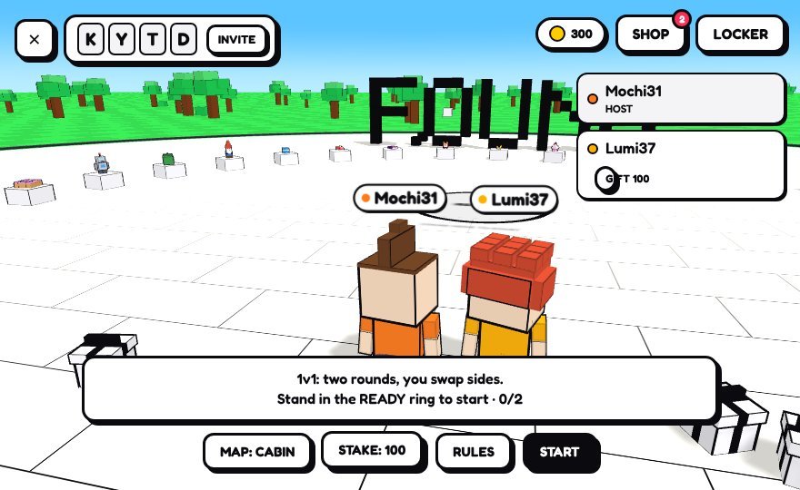
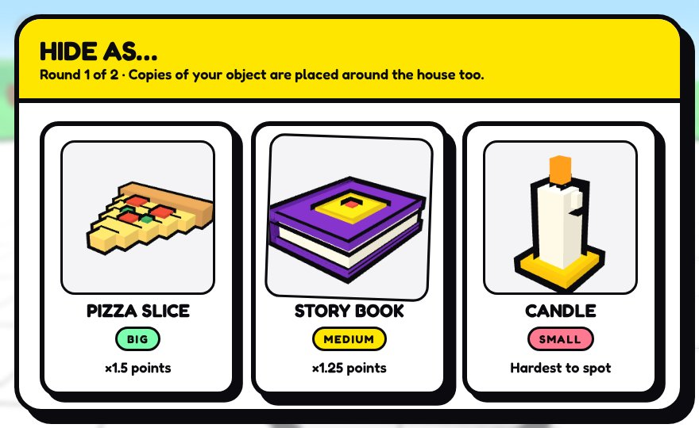
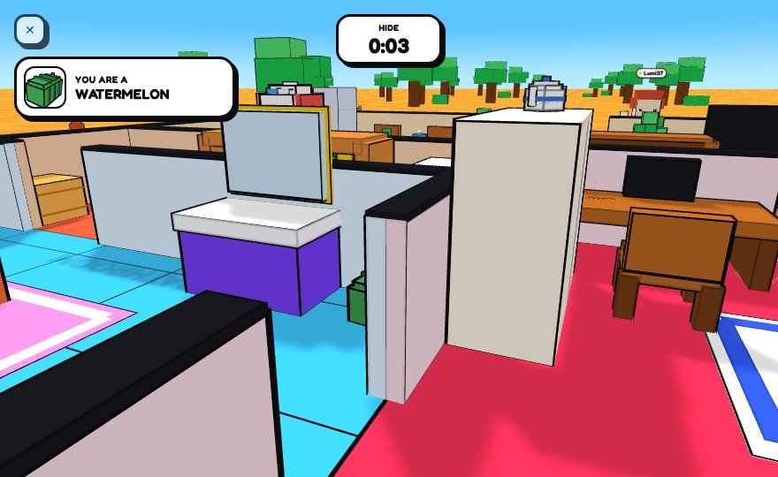
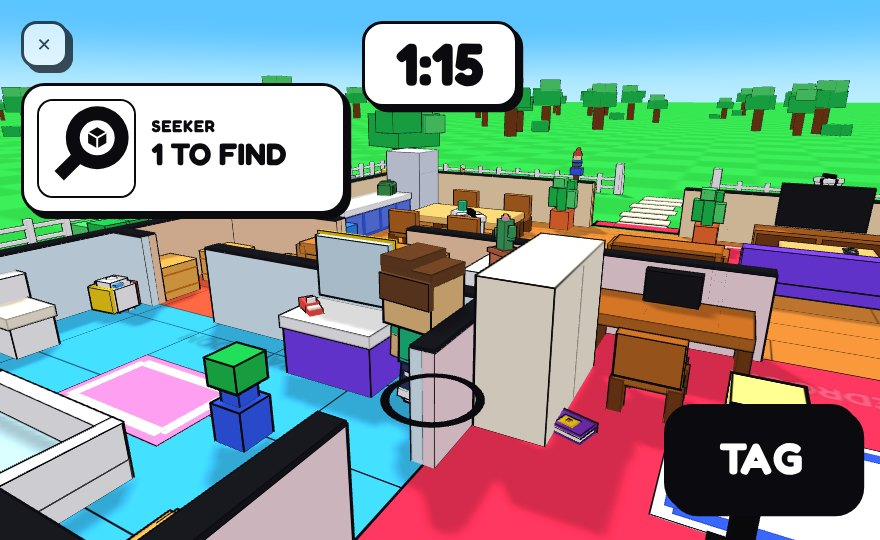
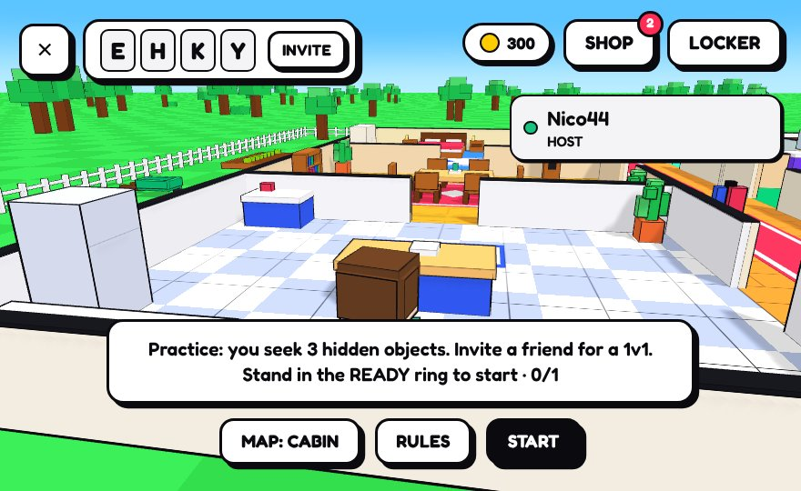
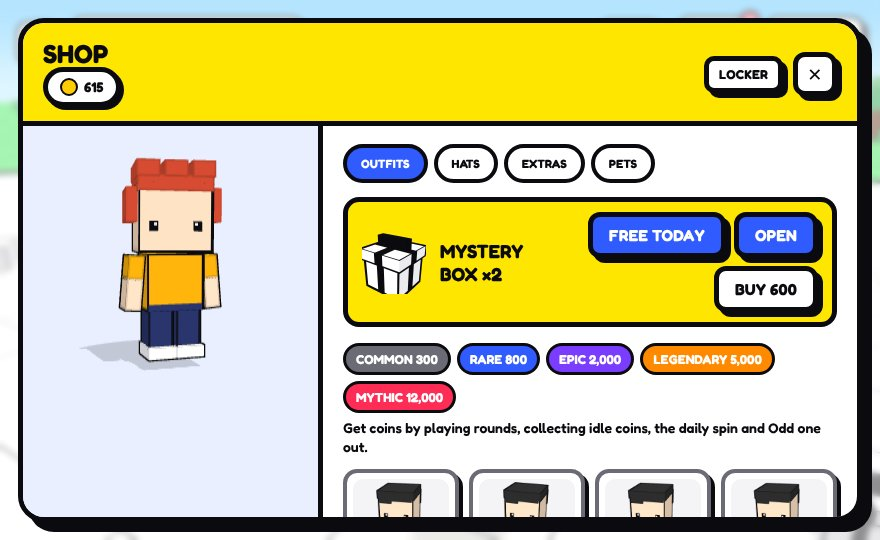

<p align="center"></p>

**FOUND** is multiplayer prop hunt with voxel characters. One player seeks. Everyone else picks an object, turns
into it, and hides somewhere in the house among ordinary copies of the same object. Open the game and you are in the
shared lobby: shoot it out on the lawn, then tap the **Hide & Seek** button to start a round.

Plain Node (20+), two dependencies (`ws`, `postgres`), no build step, three.js r128 bundled.

| Lobby | Pick | Hiding as a gnome |
|---|---|---|
|  |  |  |
| **Seeking** | **House map** | **Shop** |
|  |  |  |

See **SETUP.md** for the short version.

## Run it

```bash
npm install
npm start                 # http://localhost:3000
```

| Variable | Purpose |
|---|---|
| `PORT` | HTTP port (default 3000). |
| `DATABASE_URL` | Postgres connection string. Profiles go in `found_profiles` (one jsonb row each). Without it, a JSON file is used. |
| `DATA_FILE` | The JSON file for local play (default `data/found.json`). |
| `PGSSL=disable` | Turn TLS off for an external Postgres host that doesn't support it. |

## Playing alone

- **Walk right away:** you land in the plaza with the menu folded into the corner. WASD moves you; drag to look around.
  **Menu** opens it (Create, Join, Practice, Explore, Shop, Locker); the **–** button folds it away again.
- **Practice:** a round on your own: you seek 3 computer hiders on the Cabin. Pays a quarter of normal coins.
- **Explore:** walk the House, Cabin or Mansion with nobody else. **Next map** switches, **Rearrange** reshuffles the furniture.

## How a round works

1. **Lobby.** Everyone taps Hide & Seek then "I'm ready" to start (the host can also press Start now). The host can choose the map
   and, in a 1v1, a stake.
2. **Pick (8 s).** Hiders choose one of three objects to become: a big one (×1.5 points), a medium one (×1.25) or a
   small one. The seeker is told they are the seeker.
3. **Hide.** Hiders start together in the middle of the house and move as their object. The seeker waits at the gate
   with the screen covered and is sent no positions.
4. **Seek.** The seeker walks up to an object and tags it (E, click, or the TAG button). A hider is caught and is out
   for the rest of the round. An ordinary object costs the seeker 10 seconds. There are no hints.
5. **End.** Seekers win by catching everyone; any hider still hidden when time runs out wins.

Every round the map is rearranged from a seed the server picks: each room may be mirrored, small pieces shift, and
clutter (boxes, barrels, vases, speakers, rocks, a scarecrow and more) is scattered in new places, always clear of
doors, spawns and other furniture. Server and browser build the map from the same seed, so they agree exactly.

The map always holds 3 ordinary copies of every hider's object on floors in different rooms, plus other objects.
You can jump (Space) onto tables, beds and sofas, and jump again in the air to reach shelves and counters, then hide on
top. Everyone moves fast; you move more slowly in the air so you can land on things.

- **Seeker hints:** in the last 30% of the seek, the seeker is told which objects are still hidden; in the last 15%,
  which rooms they are in. The host can turn hints off in Rules.
- **Twitching:** a hider who stays within 2 m of the same place for 20 s starts to twitch (their object hops every couple
  of seconds) until they move.
- **Move bonus:** a hider who moves to a new spot (8 m from their last one, at least 10 s later) earns +40, up to 5 times
  a round.

| Players | Mode | Map (default) |
|---|---|---|
| 1 | Practice: you seek 3 computer-placed hiders | Cabin |
| 2 | 1v1: two rounds, swap sides, highest total wins; optional stake of 100, 250 or 500 each, winner takes the pot | Cabin |
| 3 to 6 | Party: one seeker, rotating each round | House |
| 7 to 12 | Party: two seekers | Mansion |

| Map | Size | Rooms | Hide | Seek |
|---|---|---|---|---|
| Cabin | Small | 4 | 12 s | 1:00 |
| House | Medium | 8 | 18 s | 1:30 |
| Mansion | Large | 17 | 21 s | 1:48 |

Scoring: seekers get 250 per catch and 300 for catching everyone. Hiders get 3 points per second hidden (times their
object's size bonus) and 400 for surviving.

**Rules (host, in the lobby):** hiding time (short / normal / long), seeking time, what a wrong tag costs (5 / 10 / 20 s),
copies of each object (2 / 3 / 5), and number of seekers (auto / 1 / 2). Everyone can view them. Changing one un-readies
the room. Coins don't depend on the rules: hiding points stop counting at the standard seek length.

Controls: the camera always sits behind you, a little above. WASD moves (W forward, S back, A and D sideways). Standing
still, drag to swing the camera round you (to see your face); start walking and it swings back behind you. While
walking, drag turns you. The left/right arrows turn you, drag up and down or the up/down arrows tilt the view, wheel to zoom, Space to jump,
E to tag, 1 to 6 for emotes, M opens the menu on the home screen. Phones get a joystick and buttons; drag the screen to turn.

**Settings** (the gear button on the home menu, in a party and in Explore): look speed left/right and up/down, invert
up/down, camera distance, field of view and sound. Saved in that browser.

## Coins, shop and Mystery Box

- **Coins** come from rounds: 40 plus half your round score. A normal House round pays roughly 100 to 700 depending on how you did,
  so one common item (300) takes about a round, an epic (2,000) about five, a mythic (12,000) a few hours. Practice against
  computer hiders pays a quarter and gives no win box, so it can't out-earn playing with friends.
- **Shop:** every outfit, hat, extra and pet has a fixed price by rarity: 300, 800, 2,000, 5,000 or 12,000.
- **Mystery Box:** one kind, worth about 770 coins of shop value for 600, so it's a better deal than the shop but you don't pick the item. It gives a random item you don't own (60% common, 28% rare, 9% epic, 2.5% legendary,
  0.5% mythic). You get one for winning a round, one free each day, or for 600 coins.
- **Locker:** what you own, plus hair, skin and colour.

- **Idle coins:** 30 an hour plus 2 for every item you own, for up to 8 hours away. Collect on the home screen.
- **Daily spin:** once a day: 50 to 1,000 coins or a Mystery Box.
- **Odd one out:** a 12-second menu game. 20 coins a win, 10 paid wins a day.
- **Gifting:** in the lobby, give 100 coins to anyone in your party.
- **Seasons:** the Cabin is autumn, the House summer, the Mansion winter.

- **Season 02:** eight new outfits and the Straw hat (171 items in all). `SEASON` in `src/profiles.js` is 2; bumping it wipes everyone's coins, boxes and items the next time they connect.
- **Costumes:** six new full-head outfits with glow, flame and particle effects: Dino, Shark, TV head, Pumpkin king, Unicorn and Ember dragon (177 items in all).
- **Rarity colours:** grey common, blue rare, purple epic, orange legendary, red mythic, shown on every item's border and label, with a price legend in the shop.
- **Emotes:** 1 wave, 2 cheer, 3 dance, 4 spin, 5 bow, 6 floss.

Nothing is sold for real money.

## Guns: the lobby is a free for all
Spawn is a golden **safe zone** (no shooting in or out). Aim help is off for most guns (only the weakest keep a gentle, narrow one), and weaker guns wobble more at range. Everyone who opens the game lands in the **same public lobby**, an open lawn where **guns are always on**. There are no party codes or admin switches; a new lobby opens only when the current one is full (12 players), and **Practice** gives you a private room against bots. Hold **F**, the **FIRE** button or **right-click** to shoot; number keys **1-9** (or a tap) pick a gun from the **hotbar** at the bottom. 100 HP, 3 s respawn with a 2 s shield, **barrel roll** (double-tap A or D) dodges shots.
- A kill pays **12,000 coins**; dying costs **4,000** (or whatever you have). Killing the same player again within 20 s pays nothing, so two friends cannot farm each other (`CFG.killCoins`, `deathCoins`, `repeatKillMs`).
- Floating pickups are switched off (`CFG.pickupMax` is 0); healing comes from the marble platform, regen and Med Grenades. The pickup code is still there if you want them back.
- Income: every connected player earns **2,000 coins a minute**. The **Gun Crate** lives in the shop's Guns tab: 4,000 coins, rolls a rarity by its odds (Common to Cosmic), duplicates pay 10% of the shop price back. `node tests/curve.mjs` prints the power curve and how long each tier takes to earn.

## Barrel roll
Tap **A** or **D** twice quickly (on a phone: flick the joystick left or right twice) to barrel roll that way: a fast dash with a full tumble, about 0.4 s, one per second. While rolling you dodge gun shots (the server allows one 0.45 s roll per 0.8 s). It works in the lobby and Explore, not during a round.

## What came from BITZ

- `public/avatar.js`: the BITZ voxel avatar renderer, unchanged apart from its global name and pet outlines.
- `public/avatar-data.js`: the current BITZ cosmetics merged with the legacy catalogue from commit `c8f9bd2`, which
  restores 27 dropped outfits (the `n_*` set, Bitz Piece, Season 01), 3 hats, 2 extras and 9 pets.
  Total: 77 outfits, 35 hats, 24 extras, 26 pets, 22 hairstyles.
- Accounts: identity lives in localStorage and a ten-year cookie, and the server sends the device a signed copy of the profile (`SNAP_SECRET` signs it) that restores the account after a wiped server disk. Set `DATABASE_URL` too for server-side storage.
- One public lobby that everyone joins automatically, and rejoining it after a refresh (the server remembers who is where).

## Code map

| Path | What it is |
|---|---|
| `server.js` | HTTP, one WebSocket per player, auth, party create/join/rejoin, the clocks. |
| `src/game.js` | A party: lobby → pick → hide → seek → results. Roles, decoys, tagging, modes, maps, the 1v1 pot, payouts. |
| `src/profiles.js` | Profiles, looks, coins, the shop and the Mystery Box. |
| `src/store.js` | Postgres or JSON-file persistence. |
| `public/catalog.js` | Every cosmetic with its rarity, shop prices and box odds (shared with the server). |
| `public/objects.js` | The 27 voxel props (shared). |
| `public/layout.js` | The lobby and the three maps: rooms, walls, furniture, spots, spawns, colliders (shared). |
| `public/world.js` | three.js world: maps, players and props, tagging, pathing, the chase camera, icons. |
| `public/app.js` | Socket, home, lobby, round UI, results, locker and shop. |

## Tests

```bash
npm test                                   # 52 unit + 35 integration checks (real server, two WebSocket players)
pip install playwright                     # once, for the browser test
PORT=3000 npm start & python3 tests/browser.py http://localhost:3000
```

The browser test plays a staked 1v1 with two Chrome players, then uses the shop, a Mystery Box and the locker.
On a machine with no graphics card it renders at a few frames a second; run it alone, since a busy CPU can let the
round clock run out before the test's seeker arrives.

## Deploying

`render.yaml` runs `npm start` with a `/api/ping` health check. Set `DATABASE_URL` to a Postgres database so
profiles survive restarts. Run a single instance: parties live in memory. The Postgres path has not been run against
a real database yet.

## Guns, armour and boxes (v9)
- Default health is 150. Armour (shop tab "Armour", 16 pieces) adds health and cuts damage, and many pieces have an ability: thorns, regen, dodge, berserk, last stand, ward.
- 26 guns across nine tiers, mostly plain pistols, SMGs, rifles, shotguns and snipers. No gun one-shots you. A handful carry abilities: lifesteal, burn, pierce, chain lightning, splash, crit.
- Five premium guns and two premium armours have their own very high prices (90,000 to 2,500,000) and are shop-only.
- Three boxes: Clothes Box (stock, daily and wheel), Gun Crate (4,000) and Armour Box (3,500).
- Economy: 2,000 coins a minute just for being in the lobby, 12,000 a kill, 4,000 lost per death, coin bags 5,000, round rewards x8.
- Aim help is weak and only on the weakest guns; once you are aimed right at someone every gun locks on, and better guns lock harder and wobble less.
- **The arena** is a 140 m lawn with 150 pieces of cover (rocks, walls, crates) that block shots and grenades. The 15 m white marble platform in the middle is the safe zone: it heals 7% of your health every half second, and out in the open you mend 3 hp a second after 6 s without being hit.
- **Weapon classes** (`CLASSES` in `public/guns.js`; each gun has one): pistols are twice as true standing still and worse when running (steady); SMGs, rifles and LMGs *spray* (the spread grows with every shot while you hold fire and only settles once you stop); shotguns throw a wide cone; snipers use a **scope** (hold FIRE to steady the aim and see the scope ring, release to fire; a quick tap is a wild hip shot).
- **Damage falloff**: every gun deals more up close and less far away (`fall: [near, far]`; a shotgun does 1.4x at point blank and 0.2x at range, a sniper is 0.8x close and full damage far away).
- **Gadgets** (`public/gadgets.js`, shop tab "Gadgets", press **G** or the round button beside FIRE): Frag, Flashbang (blinds and stops shooting for 2.5 s), Smoke (a cloud that blocks every shot for 7 s), Med Grenade (heals everyone near it), Napalm (burning ground), Cluster Bomb (three blasts), and the premium Mega Bomb (400,000) and Mini Nuke (1,800,000). Damage falls off with distance from the blast, never hurts the thrower, and each gadget has its own cooldown. You cannot throw from the safe zone. The server sends `nade` when one is thrown and `boom` when it goes off.

## Permanence and odds
- Nothing a player owns is ever wiped or removed. The old season reset is gone (`SEASON` is only a marker). Items that ever leave the catalogue stay in the save and simply stop being worn. Never bump the one-time `MIGRATION` again.
- Better odds: Gun Crate and Armour Box roll common 10, uncommon 20, rare 26, epic 20, legendary 12, mythic 7, celestial 3.5, cosmic 1.5 percent. The Clothes Box rolls 22, 24, 24, 16, 8, 4, 1.5, 0.5. Collecting every crate gun takes about 108 minutes of passive income alone, before kills.
